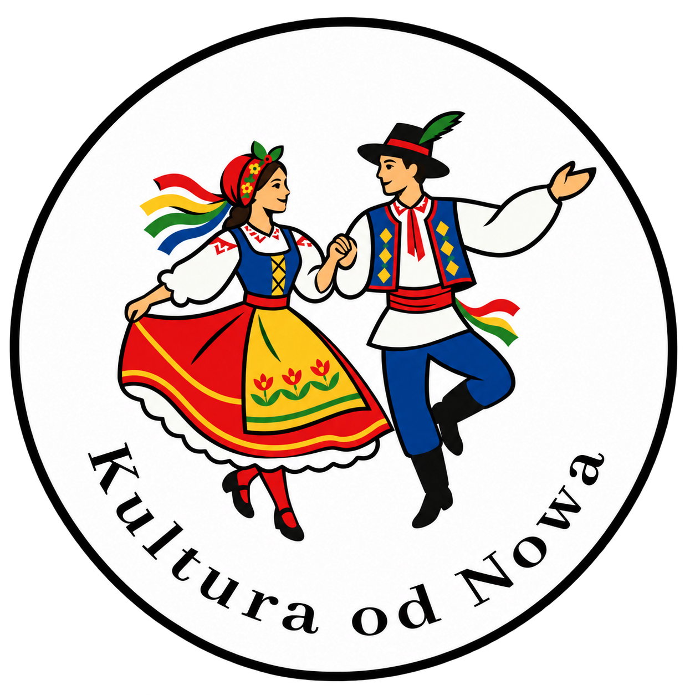

  

<h1 align="center">Kultura od Nowa</h1>

Regional words, people, and traditions from Poland.

## About the project

**Kultura od Nowa** is an educational website about regional Polish vocabulary and cultural traditions. The project was created for the **Zwolnieni z Teorii Olympiad** in Poland.

The website helps visitors discover words used in different regions, learn about local traditions, and explore the sources behind the materials.

## What you can do

- Browse a dictionary of regional Polish words and filter entries by region and category.
- Explore articles about selected Polish traditions.
- Take a short quiz and learn from the explanations after each answer.
- Follow links to the sources used for the materials.

## Regions and places covered

The materials cover the following regions and localities in Poland. Names are listed as they appear in the website:

- Beskid Śląski
- Gdańsk
- Kaszuby
- Koprzywnica
- Kujawy
- Kurpie
- Łódź i okolice
- Łukowa i okolice
- Małopolska
- Mazowsze
- Pałuki
- Podhale
- Podlasie
- Radomszczyzna
- Region łowicki
- Spycimierz
- Śląsk
- Śląsk Opolski
- Warmia
- Wielkopolska
- Żywiecczyzna

## Built with

- HTML
- CSS
- JavaScript
- GitHub Pages

The site is a lightweight static website. Its content and references are stored in the project files, with sources available on the website.

## Logo

The logo is stored in [`logo.png`](logo.png) and displayed at the top of this README. GitHub renders the image from that relative file path.
